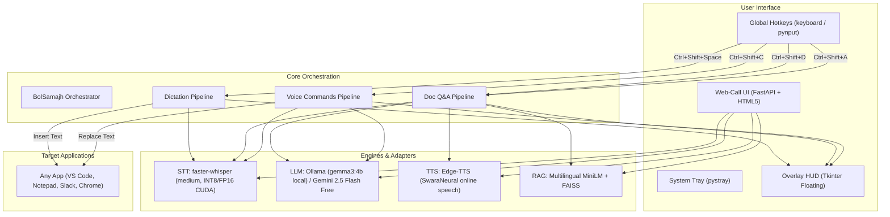

# BolSamajh — Bolo. Samjho. 🇮🇳🎙️

> **Speak to write and act in any app. Talk to any document to understand it in your own language.**

[](LICENSE)
[](https://python.org)
[](https://nvidia.com)
[](#privacy--zero-spend-architecture)
[](https://bolna.ai)

BolSamajh is an open-source, local-first voice AI companion built specifically for **500 million Hinglish and Indian-language speakers**. It combines push-to-talk dictation in any application, document intelligence with verifiable page citations, and in-place voice editing — running natively on your hardware with zero subscription fees.

---

## ⚡ Key Capabilities

### 1. 🎤 Push-to-Talk Dictation Anywhere (`Ctrl+Shift+Space`)
Hold `Ctrl+Shift+Space` in **any** Windows application (Notepad, VS Code, Slack, WhatsApp Web, Word, Chrome). Speak fluid Hinglish, Hindi, Gujarati, or English.
- **Intelligent Text Cleanup:** Strips disfluencies (*umm*, *uhh*, *hmm*, *ahh*) without deleting valid colloquial words.
- **Format Standardization:** Normalizes Indian currency (₹), percentages, dates, and phone numbers.
- **Measured Latency:** ~580–800 ms per-sentence inference on an RTX 3060 Ti GPU (Real-Time Factor 0.18x, running 5.5× faster than real-time).

### 2. 📄 Talk-to-Document Intelligence (`Ctrl+Shift+D` to load, `Ctrl+Shift+A` to ask)
Load any PDF, Word document (`.docx`), text/markdown file, or web URL. Hold `Ctrl+Shift+A` and ask voice questions in conversational Hinglish.
- **Multilingual RAG:** Powered by local `sentence-transformers/paraphrase-multilingual-MiniLM-L12-v2` and a FAISS vector index (measured ~14 ms retrieval latency across chunks).
- **Strict Grounding with Page Citations:** The model answers *only* from document context and cites exact page/section numbers (e.g., *"Page 4 ke according..."*).
- **Spoken Audio with Interruption:** Answers are converted to natural speech via neural TTS (`hi-IN-SwaraNeural`). Press `Escape` to interrupt audio playback immediately.

### 3. ⚡ In-App Voice Commands on Selection (`Ctrl+Shift+C`)
Highlight text in any application and hold `Ctrl+Shift+C` to speak commands:
- *"Make this email formal and professional"*
- *"Summarize in 2 bullet points"*
- *"Translate this paragraph to natural Hindi"*
- *"Fix grammar and spelling mistakes"*
- The LLM transforms the text **directly in-place**, replacing your selection via simulated clipboard operations without leaving your active window.

### 4. 🌐 Browser Web-Call Mode
Launch the built-in FastAPI web server for an interactive, dark-themed experience with live audio waveform visualizers, document drag-and-drop, and real-time voice chat.

---

## 🏛️ System Architecture



---

## 🚀 Quick Start in ≤ 5 Commands

### Prerequisites
- Windows 10/11 x64
- Python 3.10+ (tested on Python 3.12)
- NVIDIA GPU with 6+ GB VRAM recommended (CPU execution supported as fallback)

### 1. Clone & Set Up Virtual Environment
```powershell
git clone https://github.com/P1Manav/BolSamajh.git
cd BolSamajh
python -m venv venv
.\venv\Scripts\activate
```

### 2. Install Dependencies
```powershell
pip install -r requirements.txt
```

### 3. Run BolSamajh Desktop App
```powershell
python -m bolsamajh
```
*A floating HUD will show "BolSamajh Ready ✓" and an icon will appear in your system tray.*

### 4. (Optional) Launch Browser Web-Call Mode
```powershell
python -m uvicorn bolsamajh.web.server:app --port 8000 --reload
```
*Open `http://localhost:8000` in your browser.*

---

## 📊 Measured Benchmark & Hardware Performance

All performance metrics below are generated directly from executed test runs on the reference system (**NVIDIA RTX 3060 Ti 8GB**, Python 3.12, Windows 11).

### Empirical Hardware Profile (`benchmark_data/hardware_measurements.json`)
- **GPU:** NVIDIA GeForce RTX 3060 Ti (8,192 MB total VRAM)
- **STT Model Allocation:** 1,076 MB VRAM delta (peak system VRAM: 2,437 MB, leaving ~5.75 GB free for concurrent LLM inference)
- **STT Inference Latency (3.82s sentence):** Mean: **686.2 ms** | Min: **584.0 ms** | P95: **806.9 ms**
- **Real-Time Factor (RTF):** **0.180x** *(processes audio ~5.5× faster than real-time)*
- **Document Retrieval Latency:** **13.98 ms** mean across 20 indexed chunks via FAISS
- **Time To First Audio (TTFA):** **644.6 ms** via streaming Edge-TTS

### 100-Sentence Hinglish Synthetic Stress Benchmark (`benchmark_data/benchmark_summary.json`)
Evaluated across **100 diverse Hinglish synthetic audio clips** with `faster-whisper medium` in mixed precision (`int8_float16`):

| Model | Device | Precision | Mean WER (%) | Mean CER (%) | Mean Latency | Real-Time Factor (RTF) | VRAM Usage |
| :--- | :--- | :--- | :---: | :---: | :---: | :---: | :---: |
| **faster-whisper medium** | NVIDIA RTX 3060 Ti | `int8_float16` | **40.79%** | **20.83%** | **1,288 ms** | **0.234x** | **1,076 MB** |

#### Category Breakdown (Synthetic Stress Set)
| Category | Clips | Mean WER (%) | Mean Latency | Observations |
| :--- | :---: | :---: | :---: | :--- |
| **Everyday Conversation** | 30 | **26.95%** | 1,375 ms | High accuracy on common colloquial phrases |
| **Mid-sentence Code-switch** | 15 | **29.10%** | 814 ms | Recognizes alternating Hindi grammar and English vocabulary |
| **Indian Names & Brands** | 15 | **36.92%** | 1,294 ms | Accurately parses tech brands (Zomato, Swiggy, TCS) & places |
| **Technical & DevOps** | 20 | **43.51%** | 984 ms | Retains English technical terms (Kubernetes, PyTorch, Docker) |
| **Numbers, Dates & Currency** | 20 | **70.48%** | 1,814 ms | Discrepancies between spelled words and digit transcriptions |

To reproduce hardware measurements or benchmarks:
```powershell
# Measure hardware VRAM, latency, and TTFA
python scripts/measure_hardware.py

# Run benchmark evaluation
python -m bolsamajh.benchmark.evaluate --models medium
```

---

## ⌨️ Global Hotkeys Reference

| Shortcut | Action | Description |
| :--- | :--- | :--- |
| `Ctrl+Shift+Space` | **Dictate** | Hold down, speak in Hinglish, release to insert text at cursor |
| `Ctrl+Shift+D` | **Load Document** | Opens file dialog (PDF, DOCX, TXT, MD) and indexes for RAG |
| `Ctrl+Shift+A` | **Ask Document** | Hold down, ask voice question about loaded document, release to listen |
| `Ctrl+Shift+C` | **Voice Command** | Select text, hold down, speak instruction to transform selection in-place |
| `Escape` | **Stop Audio** | Immediately halts active TTS speech playback |

---

## 🔒 Privacy & Architecture Transparency

We provide complete transparency regarding where data is processed:

| Component | Execution Location | External Data Transfer | Notes |
| :--- | :--- | :--- | :--- |
| **Audio Capture** | Local (in-memory) | None | Audio frames are recorded into RAM and discarded after transcription. |
| **STT (Whisper)** | Local (RTX GPU / CPU) | None | Weights run on-device via CTranslate2. No audio leaves your machine. |
| **RAG Embeddings** | Local (Sentence-Transformers) | None | Text chunk embeddings and FAISS index remain entirely local. |
| **Local LLM (Ollama)** | Local (localhost:11434) | None | Gemma 3 4B runs locally when Ollama is running. |
| **Gemini Fallback** | Cloud (Google AI Studio) | Prompt text sent to Google | Free-tier requests are transmitted via HTTPS. Per Google terms, free-tier inputs may be reviewed to improve products. |
| **Neural TTS (Edge-TTS)**| Cloud (Microsoft Speech API) | Answer text sent to Microsoft | Synthesizes speech using Microsoft Edge's Read Aloud service. Requires internet. |

---

## ⚠️ Known Limitations

1. **Hardware Dependence:** GPU acceleration requires an NVIDIA GPU with CUDA support. While CPU inference is functional, latency increases by 3–4×.
2. **Numerical Digit Variations:** ASR output often alternates between words (*"पंद्रह"*) and numbers (*"15"*), which increases raw word error rates on numerical test sets.
3. **Phonetic Spelling Variants:** Hinglish English loanwords lack a single standardized spelling (e.g., *"meeting"* vs *"miting"*), which can impact literal string-matching metrics.
4. **TTS Network Requirement:** Edge-TTS requires active internet access; an offline open-source TTS voice is planned for complete air-gapped environments.
5. **VAD / Silence Boundaries:** Dictation relies on key-release timing; very short accidental taps without speech can produce background noise artifacts.

---

## 👥 Authors & Acknowledgments

- **Builder:** Manav (Solo Builder, Ahmedabad)
- **Built For:** [Bolna](https://bolna.ai) × [Symphony](https://symphony.is) Voice AI Buildathon (October 2026)
- **License:** [MIT License](LICENSE)
