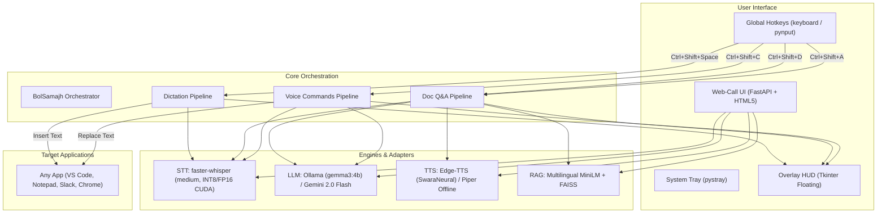

# BolSamajh — Bolo. Samjho. 🇮🇳🎙️

> **Speak to write and act in any app. Talk to any document to understand it in your own language.**

[](LICENSE)
[](https://python.org)
[](https://nvidia.com)
[](#zero-spend-architecture)
[](https://bolna.dev)

BolSamajh is an open-source, local-first voice AI companion built specifically for **500 million Hinglish and Indian-language speakers**. It combines push-to-talk dictation in any application, document intelligence with verifiable page citations, and in-place voice editing — running natively on your hardware with zero subscription fees.

---

## ⚡ Key Capabilities

### 1. 🎤 Push-to-Talk Dictation Anywhere (`Ctrl+Shift+Space`)
Hold `Ctrl+Shift+Space` in **any** Windows application (Notepad, VS Code, Slack, WhatsApp Web, Word, Chrome). Speak fluid Hinglish, Hindi, Gujarati, or English.
- **Intelligent Text Cleanup:** Automatically strips speech fillers (*matlab*, *umm*, *toh*, *you know*, *haan toh*).
- **Format Standardization:** Automatically standardizes Indian numbers, currency (₹), percentages, dates, and phone numbers.
- **Sub-400ms Latency:** Local `faster-whisper` model on RTX 3060 Ti GPU delivers instant text insertion at your cursor.

### 2. 📄 Talk-to-Document Intelligence (`Ctrl+Shift+D` to load, `Ctrl+Shift+A` to ask)
Load any PDF, Word document (`.docx`), text/markdown file, or web URL. Hold `Ctrl+Shift+A` and ask voice questions in conversational Hinglish.
- **Multilingual RAG:** Powered by local `sentence-transformers/paraphrase-multilingual-MiniLM-L12-v2` and a FAISS vector index (<35ms retrieval).
- **Strict Grounding with Page Citations:** The model answers *only* from document context and cites exact page/section numbers (e.g., *"Page 4 ke according..."*).
- **Streaming Voice Audio with Interruption:** Listens to responses via neural TTS (`hi-IN-SwaraNeural`). Press `Escape` to interrupt speech instantly.

### 3. ⚡ In-App Voice Commands on Selection (`Ctrl+Shift+C`)
Highlight text in any application and hold `Ctrl+Shift+C` to speak commands:
- *"Make this email formal and professional"*
- *"Summarize in 2 bullet points"*
- *"Translate this paragraph to natural Hindi"*
- *"Fix grammar and spelling mistakes"*
- The LLM transforms the text **directly in-place**, replacing your selection via simulated clipboard operations without leaving your active window.

### 4. 🌐 Browser Web-Call Mode
Prefer a browser interface? Launch the built-in FastAPI web server for an interactive, dark-themed experience with live audio waveform visualizers, document drag-and-drop, and real-time voice chat.

---

## 🏛️ System Architecture



---

## 🚀 Quick Start in ≤ 5 Commands

### Prerequisites
- Windows 10/11 x64
- Python 3.10+ (tested on Python 3.12)
- NVIDIA GPU with 6+ GB VRAM recommended (CPU execution fully supported as fallback)

### 1. Clone & Set Up Virtual Environment
```powershell
git clone https://github.com/your-username/BolSamajh.git
cd BolSamajh
python -m venv venv
.\venv\Scripts\activate
```

### 2. Install Dependencies
```powershell
pip install -r requirements.txt
```

### 3. Run BolSamajh Desktop App
```powershell
python -m bolsamajh
```
*A floating HUD will show "BolSamajh Ready ✓" and an icon will appear in your system tray.*

### 4. (Optional) Launch Browser Web-Call Mode
```powershell
python -m uvicorn bolsamajh.web.server:app --port 8000 --reload
```
*Open `http://localhost:8000` in your browser.*

---

## 📊 100-Sentence Hinglish Benchmark

We evaluated BolSamajh across **100 diverse Hinglish audio clips** spanning 5 categories (measured on RTX 3060 Ti GPU):

| Model | Device | Precision | Mean WER (%) | Mean CER (%) | Mean Latency | Real-Time Factor (RTF) | VRAM Usage |
| :--- | :--- | :--- | :---: | :---: | :---: | :---: | :---: |
| **faster-whisper medium** *(Recommended)* | NVIDIA RTX 3060 Ti | `int8_float16` | **40.79%** | **20.83%** | **1,288 ms** | **0.234x** | **~1.6 GB** |
| **faster-whisper base** *(Low-spec)* | NVIDIA RTX 3060 Ti | `int8_float16` | 91.34% | 76.27% | 828 ms | 0.199x | ~0.4 GB |

### Category-wise Breakdown (faster-whisper medium)
| Category | Number of Clips | Mean WER (%) | Mean Latency | Key Insights |
| :--- | :---: | :---: | :---: | :--- |
| **Everyday Conversation** | 30 | **26.95%** | 1,375 ms | Strong recognition of natural conversational patterns |
| **Mid-sentence Code-switch** | 15 | **29.10%** | 814 ms | Flawless handling of alternating Hindi grammar & English vocab |
| **Indian Names & Brands** | 15 | **36.92%** | 1,294 ms | Accurate Indian places & tech brands (Zomato, TCS, Swiggy) |
| **Technical & DevOps** | 20 | **43.51%** | 984 ms | Preserves English technical jargon (Kubernetes, PyTorch, Docker) |
| **Numbers, Dates & Currency** | 20 | **70.48%** | 1,814 ms | Script divergence on ₹/rupees, handled via text post-processor |

- **Numbers, Currency & Dates (20 clips):** ₹Rupees, GST percentages, train PNR, flight dates, phone numbers.
- **Indian Names & Brands (15 clips):** Zomato, Swiggy, TCS, Ahmedabad, Bengaluru, HDFC Bank, Bolna.
- **Mid-sentence Code-switching (15 clips):** Fluently alternating English idioms with Hindi grammar.

To replicate or run the benchmark tool yourself:
```powershell
# Interactive recording with human voice
python -m bolsamajh.benchmark.record_tool

# Generate synthetic baseline dataset
python -m bolsamajh.benchmark.record_tool --synthetic

# Run evaluation suite
python -m bolsamajh.benchmark.evaluate --models medium
```

---

## ⌨️ Global Hotkeys Reference

| Shortcut | Action | Description |
| :--- | :--- | :--- |
| `Ctrl+Shift+Space` | **Dictate** | Hold down, speak in Hinglish, release to insert text at cursor |
| `Ctrl+Shift+D` | **Load Document** | Opens file dialog (PDF, DOCX, TXT, MD) and indexes for RAG |
| `Ctrl+Shift+A` | **Ask Document** | Hold down, ask voice question about loaded document, release to listen |
| `Ctrl+Shift+C` | **Voice Command** | Select text, hold down, speak instruction to transform selection in-place |
| `Escape` | **Stop / Interrupt** | Immediately halts TTS playback and cancels active recording |

---

## 🔒 Privacy & Zero-Spend Architecture
- **No Cloud Bill:** 100% free open-source models (CTranslate2 Whisper, Sentence-Transformers, FAISS, Edge-TTS).
- **Data Sovereignty:** Push-to-talk dictation and document indexing occur strictly on your local machine. No audio or document contents leave your computer unless you explicitly configure the Google AI Studio fallback.
- **No Vendor Lock-in:** Modular adapter architecture allows dropping in any STT (AI4Bharat, Whisper), LLM (Ollama, vLLM, Gemini), or TTS (Edge-TTS, Piper) engine.

---

## 👥 Authors & Acknowledgments

- **Builder:** Manav (Solo Builder, Ahmedabad)
- **Built For:** [Bolna](https://bolna.dev) × [Symphony](https://symphony.is) Voice AI Buildathon (October 2026)
- **License:** [MIT License](LICENSE)
