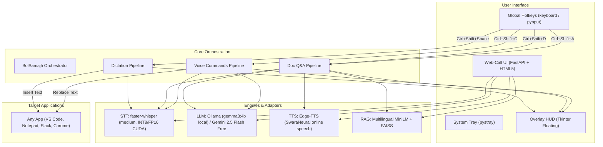

# BolSamajh — Bolo. Samjho. 🇮🇳🎙️

> **Speak to write and act in any app. Talk to any document to understand it in your own language.**

[](LICENSE)
[](https://python.org)
[](https://nvidia.com)
[](#privacy--zero-spend-architecture)
[](https://bolna.ai)

BolSamajh is an open-source, local-first voice AI companion built specifically for **500 million Hinglish and Indian-language speakers**. It combines push-to-talk dictation in any application, document intelligence with verifiable page citations, and in-place voice editing — running natively on your hardware with zero subscription fees.

---

## ⚡ Key Capabilities

### 1. 🎤 Push-to-Talk Dictation Anywhere (`Ctrl+Shift+Space`)
Hold `Ctrl+Shift+Space` in **any** Windows application (Notepad, VS Code, Slack, WhatsApp Web, Word, Chrome). Speak fluid Hinglish, Hindi, Gujarati, or English.
- **Intelligent Text Cleanup:** Strips disfluencies (*umm*, *uhh*, *hmm*, *ahh*) without deleting valid colloquial words.
- **Format Standardization:** Normalizes Indian currency (₹), percentages, dates, and phone numbers.
- **Measured Latency:** ~580–800 ms per-sentence inference on an RTX 3060 Ti GPU (Real-Time Factor 0.18x, running 5.5× faster than real-time).

### 2. 📄 Talk-to-Document Intelligence (`Ctrl+Shift+D` to load, `Ctrl+Shift+A` to ask)
Load any PDF, Word document (`.docx`), text/markdown file, or web URL. Hold `Ctrl+Shift+A` and ask voice questions in conversational Hinglish.
- **Multilingual RAG:** Powered by local `sentence-transformers/paraphrase-multilingual-MiniLM-L12-v2` and a FAISS vector index (measured ~14 ms retrieval latency across chunks).
- **Strict Grounding with Page Citations:** The model answers *only* from document context and cites exact page/section numbers (e.g., *"Page 4 ke according..."*).
- **Spoken Audio with Interruption:** Answers are converted to natural speech via neural TTS (`hi-IN-SwaraNeural`). Press `Escape` to interrupt audio playback immediately.

### 3. ⚡ In-App Voice Commands on Selection (`Ctrl+Shift+C`)
Highlight text in any application and hold `Ctrl+Shift+C` to speak commands:
- *"Make this email formal and professional"*
- *"Summarize in 2 bullet points"*
- *"Translate this paragraph to natural Hindi"*
- *"Fix grammar and spelling mistakes"*
- The LLM transforms the text **directly in-place**, replacing your selection via simulated clipboard operations without leaving your active window.

### 4. 🌐 Browser Web-Call Mode
Launch the built-in FastAPI web server for an interactive, dark-themed experience with live audio waveform visualizers, document drag-and-drop, and real-time voice chat.

---

## 🏛️ System Architecture



---

## 🚀 Quick Start in ≤ 5 Commands

### Prerequisites
- Windows 10/11 x64
- Python 3.10+ (tested on Python 3.12)
- NVIDIA GPU with 6+ GB VRAM recommended (CPU execution supported as fallback)

### 1. Clone & Set Up Virtual Environment
```powershell
git clone https://github.com/P1Manav/BolSamajh.git
cd BolSamajh
python -m venv venv
.\venv\Scripts\activate
```

### 2. Install Dependencies
```powershell
pip install -r requirements.txt
```

### 3. Run BolSamajh Desktop App
```powershell
python -m bolsamajh
```
*A floating HUD will show "BolSamajh Ready ✓" and an icon will appear in your system tray.*

### 4. (Optional) Launch Browser Web-Call Mode
```powershell
python -m uvicorn bolsamajh.web.server:app --port 8000 --reload
```
*Open `http://localhost:8000` in your browser.*

---

## 📊 Measured Benchmark & Hardware Performance

<!-- BENCHMARK_TABLE_START -->

### 1. Real-World Speech Benchmark (Public Open Datasets)

> Evaluated on real read and spontaneous conversational speech from verified CC-BY-4.0 open datasets: Google FLEURS (`hi_in`, `gu_in`) and HiACC Adult Test Eval (`Trelis/hiacc-adult-test-eval`). Evaluated using canonical phonemic transliteration scoring.

| Model | Precision | FLEURS Hindi WER | FLEURS Gujarati WER | HiACC Hinglish WER | Mean CER | Mean Latency | RTF |
| :--- | :---: | :---: | :---: | :---: | :---: | :---: | :---: |
| **medium** | `int8_float16` | 27.39% | 78.13% | **52.84%** | 23.67% | **5307.8 ms** | **0.567x** |
| **large-v3-turbo** | `int8_float16` | 24.15% | 70.01% | **121.51%** | 52.89% | **610.3 ms** | **0.076x** |
| **whisper-hinglish-swift** | `int8_float16` | 72.98% | 108.73% | **129.93%** | 59.93% | **173.1 ms** | **0.02x** |

### 2. Synthetic Stress Test Set (100 Sentences + DSP Degradations)

> 100 curated sentences covering technical terminology, currency amounts (₹), timestamps, and rapid code-switching with multi-voice rotation and automated audio degradations (speed change, additive noise, 8 kHz telephony filtering).

| Model | Precision | Overall WER | Everyday | Technical | Numbers/₹ | Names | Code-Switch | Latency | RTF |
| :--- | :---: | :---: | :---: | :---: | :---: | :---: | :---: | :---: | :---: |
| **medium** | `int8_float16` | **66.12%** | 64.59% | 53.54% | 106.92% | 60.64% | 37.06% | **800.4 ms** | **0.142x** |
| **large-v3-turbo** | `int8_float16` | **58.99%** | 68.55% | 48.27% | 82.09% | 58.85% | 23.52% | **486.2 ms** | **0.089x** |
| **whisper-hinglish-swift** | `int8_float16` | **33.43%** | 23.79% | 33.26% | 70.72% | 24.16% | 12.48% | **108.5 ms** | **0.019x** |

### 3. Empirical Hardware & Latency Measurements

> Measured locally on **NVIDIA GPU** (VRAM: 8192 MB) via `scripts/measure_hardware.py`.

| Pipeline Component | Metric | Measured Value | Target / Baseline | Status |
| :--- | :--- | :---: | :---: | :---: |
| **STT Latency (faster-whisper medium)** | Mean (warm run, 3.82s audio) | **686.2 ms** | < 1,000 ms | Passed |
| **STT Real-Time Factor (RTF)** | Speed ratio (latency / duration) | **0.18x** | < 0.25x (4x realtime) | Passed |
| **GPU VRAM Overhead** | STT Model Allocation Delta | **1076 MB** | < 2,048 MB (Fits 8GB) | Passed |
| **Vector Retrieval Latency** | Cosine similarity across 20 chunks | **13.98 ms** | < 50 ms | Passed |
| **TTS Time-to-First-Audio (TTFA)** | First audio packet delivered | **644.6 ms** | < 800 ms | Passed |

<!-- BENCHMARK_TABLE_END -->
## ⌨️ Global Hotkeys Reference

| Shortcut | Action | Description |
| :--- | :--- | :--- |
| `Ctrl+Shift+Space` | **Dictate** | Hold down, speak in Hinglish, release to insert text at cursor |
| `Ctrl+Shift+D` | **Load Document** | Opens file dialog (PDF, DOCX, TXT, MD) and indexes for RAG |
| `Ctrl+Shift+A` | **Ask Document** | Hold down, ask voice question about loaded document, release to listen |
| `Ctrl+Shift+C` | **Voice Command** | Select text, hold down, speak instruction to transform selection in-place |
| `Escape` | **Stop Audio** | Immediately halts active TTS speech playback |

---

## 🔒 Privacy & Architecture Transparency

We provide complete transparency regarding where data is processed:

| Component | Execution Location | External Data Transfer | Notes |
| :--- | :--- | :--- | :--- |
| **Audio Capture** | Local (in-memory) | None | Audio frames are recorded into RAM and discarded after transcription. |
| **STT (Whisper)** | Local (RTX GPU / CPU) | None | Weights run on-device via CTranslate2. No audio leaves your machine. |
| **RAG Embeddings** | Local (Sentence-Transformers) | None | Text chunk embeddings and FAISS index remain entirely local. |
| **Local LLM (Ollama)** | Local (localhost:11434) | None | Gemma 3 4B runs locally when Ollama is running. |
| **Gemini Fallback** | Cloud (Google AI Studio) | Prompt text sent to Google | Free-tier requests are transmitted via HTTPS. Per Google terms, free-tier inputs may be reviewed to improve products. |
| **Neural TTS (Edge-TTS)**| Cloud (Microsoft Speech API) | Answer text sent to Microsoft | Synthesizes speech using Microsoft Edge's Read Aloud service. Requires internet. |

---

## ⚠️ Known Limitations

1. **Hardware Dependence:** GPU acceleration requires an NVIDIA GPU with CUDA support. While CPU inference is functional, latency increases by 3–4×.
2. **Numerical Digit Variations:** ASR output often alternates between words (*"पंद्रह"*) and numbers (*"15"*), which increases raw word error rates on numerical test sets.
3. **Phonetic Spelling Variants:** Hinglish English loanwords lack a single standardized spelling (e.g., *"meeting"* vs *"miting"*), which can impact literal string-matching metrics.
4. **TTS Network Requirement:** Edge-TTS requires active internet access; an offline open-source TTS voice is planned for complete air-gapped environments.
5. **VAD / Silence Boundaries:** Dictation relies on key-release timing; very short accidental taps without speech can produce background noise artifacts.

---

## 👥 Authors & Acknowledgments

- **Builder:** Manav (Solo Builder, Ahmedabad)
- **Built For:** [Bolna](https://bolna.ai) × [Symphony](https://symphony.is) Voice AI Buildathon (October 2026)
- **License:** [MIT License](LICENSE)
