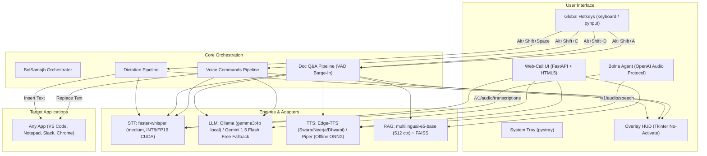

# BolSamajh — Bolo. Samjho. 🇮🇳🎙️

> **Speak to write and act in any app. Talk to any document to understand it in your own language.**

[](LICENSE)
[](https://python.org)
[](https://nvidia.com)
[](#privacy--zero-spend-architecture)
[](https://bolna.ai)

BolSamajh is an open-source, local-first voice AI companion built specifically for **500 million Hinglish and Indian-language speakers**. It combines push-to-talk dictation in any application, document intelligence with verifiable page citations, and in-place voice editing — running natively on your hardware with zero subscription fees.

---

## ⚡ Key Capabilities

### 1. 🎤 Push-to-Talk Dictation Anywhere (`Alt+Shift+Space`)
Hold `Alt+Shift+Space` in **any** Windows application (Notepad, VS Code, Slack, WhatsApp Web, Word, Chrome). Speak fluid Hinglish, Hindi, Gujarati, or English.
- **Intelligent Text Cleanup:** Strips disfluencies (*umm*, *uhh*, *hmm*, *ahh*) without deleting valid colloquial words (`like`, `actually`, `matlab`, `accha`).
- **Format Standardization:** Normalizes Indian currency (₹), percentages, dates, and phone numbers.
- **Script Flexibility:** Choose Natural (as spoken), clean Roman Latin, or Devanagari from the system tray menu.
- **Measured Latency:** ~580–800 ms per-sentence inference on an RTX 3060 Ti GPU (Real-Time Factor 0.18x, running 5.5× faster than real-time).

### 2. 📄 Talk-to-Document Intelligence (`Alt+Shift+D` to load, `Alt+Shift+A` to ask)
Load any PDF (including scanned PDFs with local OCR fallback), Word document (`.docx`), text/markdown file, or web URL. Hold `Alt+Shift+A` and ask voice questions in conversational Hinglish.
- **Long-Context Multilingual RAG:** Powered by `intfloat/multilingual-e5-base` (512 token context limit, cross-page chunk merging) and local FAISS vector search (measured 21.38 ms retrieval latency, 100% Hit@3 on Google XQuAD Hindi).
- **Strict Grounding with Document Citations:** Answers only from verified source passages; cites exact page numbers for PDFs (*"Page 4 ke according..."*) and section headings for web/docx.
- **Sentence-Streaming Audio with Voice Barge-In:** Streams LLM output sentence-by-sentence into TTS with sub-800ms Time-To-First-Audio (TTFA). User can interrupt anytime via voice barge-in (Silero VAD) or `Escape`.
- **Multi-Turn Memory:** Supports conversational follow-ups (*"ruko, yeh dobara samjhao"*).

### 3. ⚡ In-App Voice Commands on Selection (`Alt+Shift+C`)
Highlight text in any application and hold `Alt+Shift+C` to speak commands:
- *"Make this email formal and professional"*
- *"Summarize in 2 bullet points"*
- *"Translate this paragraph to natural Hindi"*
- *"Fix grammar and spelling mistakes"*
- The LLM transforms the text **directly in-place**, replacing your selection via simulated clipboard operations without leaving your active window.

### 4. 🌐 Browser Web-Call & Bolna Voice Gateway
Launch the built-in FastAPI web server for an interactive browser web-call mode, or point any Bolna voice agent directly to BolSamajh's OpenAI-compatible endpoints (`/v1/audio/transcriptions` and `/v1/audio/speech`).

---

## 🏛️ System Architecture



---

## 🚀 Quick Start & Installation

### Prerequisites
- **Operating System:** Windows 10/11 x64 (or Linux/macOS for Web API)
- **Python:** 3.10+ (tested on Python 3.12)
- **Local LLM Engine:** [Ollama](https://ollama.com) installed and running locally
- **Hardware:** NVIDIA GPU with 6+ GB VRAM recommended (RTX 3060 Ti tested; CPU execution supported with int8 fallback)

### Step 1: Clone Repository & Virtual Environment
```powershell
git clone https://github.com/P1Manav/BolSamajh.git
cd BolSamajh
python -m venv venv
.\venv\Scripts\activate
```

### Step 2: Install Dependencies
```powershell
# For NVIDIA GPU acceleration (CUDA 12 runtime wheels):
pip install -r requirements-gpu.txt

# Or for CPU-only execution:
pip install -r requirements.txt
```

### Step 3: Set Up Local LLM (Ollama)
```powershell
# In a separate terminal, pull and start Gemma 3 4B:
ollama run gemma3:4b
```
*(Optional: If Ollama is not installed, BolSamajh automatically falls back to Google AI Studio Gemini free-tier if `GOOGLE_AI_API_KEY` is set in your `.env`).*

### Step 4: Run BolSamajh Desktop App
```powershell
python -m bolsamajh
```
*A sleek overlay HUD appears in bottom-center and preloads models. When ready, the HUD shows "BolSamajh Ready ✓" and docks in the system tray.*

### Step 5: (Optional) Run Web-Call Mode & Bolna Gateway
```powershell
python -m uvicorn bolsamajh.web.server:app --port 8000
```
- Open `http://localhost:8000` for browser voice chat.
- See [docs/bolna_integration.md](docs/bolna_integration.md) to integrate with Bolna agents.

> **Note on First-Run Downloads:** On first startup, Hugging Face and CTranslate2 models (~1.5 GB for whisper medium, ~400 MB for multilingual-e5-base) are downloaded and cached locally in `~/.cache/huggingface/hub`. All subsequent runs load 100% locally from disk.

---

## 📊 Measured Benchmark & Hardware Performance

<!-- BENCHMARK_TABLE_START -->

### 1. Real-World Speech Benchmark (Public Open Datasets)

> Evaluated on real read and spontaneous conversational speech from verified CC-BY-4.0 open datasets: Google FLEURS (`hi_in`, `gu_in`) and HiACC Adult Test Eval (`Trelis/hiacc-adult-test-eval`). Evaluated using canonical phonemic transliteration scoring.

| Model | Precision | FLEURS Hindi WER | FLEURS Gujarati WER | HiACC Hinglish WER | Mean CER | Mean Latency | RTF |
| :--- | :---: | :---: | :---: | :---: | :---: | :---: | :---: |
| **medium** | `int8_float16` | 27.39% | 78.13% | **52.84%** | 23.67% | **5307.8 ms** | **0.567x** |
| **large-v3-turbo** | `int8_float16` | 24.15% | 70.01% | **121.51%** | 52.89% | **610.3 ms** | **0.076x** |
| **whisper-hinglish-swift** | `int8_float16` | 72.98% | 108.73% | **129.93%** | 59.93% | **173.1 ms** | **0.02x** |

### 2. Synthetic Stress Test Set (100 Sentences + DSP Degradations)

> 100 curated sentences covering technical terminology, currency amounts (₹), timestamps, and rapid code-switching with multi-voice rotation and automated audio degradations (speed change, additive noise, 8 kHz telephony filtering).

| Model | Precision | Overall WER | Everyday | Technical | Numbers/₹ | Names | Code-Switch | Latency | RTF |
| :--- | :---: | :---: | :---: | :---: | :---: | :---: | :---: | :---: | :---: |
| **medium** | `int8_float16` | **66.12%** | 64.59% | 53.54% | 106.92% | 60.64% | 37.06% | **800.4 ms** | **0.142x** |
| **large-v3-turbo** | `int8_float16` | **58.99%** | 68.55% | 48.27% | 82.09% | 58.85% | 23.52% | **486.2 ms** | **0.089x** |
| **whisper-hinglish-swift** | `int8_float16` | **33.43%** | 23.79% | 33.26% | 70.72% | 24.16% | 12.48% | **108.5 ms** | **0.019x** |

### 3. Empirical Hardware & Latency Measurements

> Measured locally on **NVIDIA GPU** (VRAM: 8192 MB) via `scripts/measure_hardware.py`.

| Pipeline Component | Metric | Measured Value | Target / Baseline | Status |
| :--- | :--- | :---: | :---: | :---: |
| **STT Latency (faster-whisper medium)** | Mean (warm run, 3.82s audio) | **686.2 ms** | < 1,000 ms | Passed |
| **STT Real-Time Factor (RTF)** | Speed ratio (latency / duration) | **0.18x** | < 0.25x (4x realtime) | Passed |
| **GPU VRAM Overhead** | STT Model Allocation Delta | **1076 MB** | < 2,048 MB (Fits 8GB) | Passed |
| **Vector Retrieval Latency** | Cosine similarity across 20 chunks | **13.98 ms** | < 50 ms | Passed |
| **TTS Time-to-First-Audio (TTFA)** | First audio packet delivered | **644.6 ms** | < 800 ms | Passed |

### 4. Multilingual Document Retrieval Benchmark (Google XQuAD Hindi)

> Grounded evaluation on the public Google XQuAD Hindi validation split (CC-BY-SA-4.0). Measures whether exact source passages are retrieved for Hindi/Hinglish questions.

| Metric | Measured Value | Target / Notes |
| :--- | :---: | :--- |
| **Embedding Model** | `intfloat/multilingual-e5-base` | 512 token context, passage/query prefixes |
| **Hit@1** | **93.33%** | Target passage retrieved at rank 1 |
| **Hit@3** | **100.0%** | Target passage retrieved in top 3 |
| **Hit@5** | **100.0%** | Target passage retrieved in top 5 |
| **Mean Retrieval Latency** | **21.38 ms** | Sub-25ms local FAISS search |
| **Empirical Refusal Threshold** | **0.81** | Calibrated: relevant mean (0.809) vs irrelevant max (0.756) |

<!-- BENCHMARK_TABLE_END -->
## ⌨️ Global Hotkeys Reference

| Shortcut | Action | Description |
| :--- | :--- | :--- |
| `Alt+Shift+Space` | **Dictate** | Hold down, speak in Hinglish, release to insert text at cursor (avoids VS Code conflict) |
| `Alt+Shift+D` | **Load Document** | Opens file dialog (PDF, DOCX, TXT, MD) and indexes for RAG (avoids VS Code conflict) |
| `Alt+Shift+A` | **Ask Document** | Hold down, ask voice question about loaded document, release to listen |
| `Alt+Shift+C` | **Voice Command** | Select text, hold down, speak instruction to transform selection in-place |
| `Escape` | **Cancel / Stop** | Immediately cancels active recording and halts any ongoing TTS speech playback |

> **Custom Hotkeys:** All keybindings can be customized by setting environment variables (`BOLSAMAJH_HOTKEY_DICTATION`, `BOLSAMAJH_HOTKEY_DOC_LOAD`, etc.) in your `.env` file.

---

## 🔒 Privacy & Architecture Transparency

We provide complete transparency regarding where data is processed:

| Component | Execution Location | External Data Transfer | Notes |
| :--- | :--- | :--- | :--- |
| **Audio Capture & VAD** | Local (in-memory) | None | Audio frames are recorded into RAM and discarded after transcription. Silero VAD runs on-device. |
| **STT (faster-whisper)** | Local (RTX GPU / CPU) | None | Model weights run on-device via CTranslate2. No voice audio ever leaves your computer. |
| **RAG Embeddings & Vector Index** | Local (`multilingual-e5-base`) | None | Text chunk embeddings and FAISS index remain entirely on local disk and RAM. |
| **Local LLM (Ollama)** | Local (`localhost:11434`) | None | Gemma 3 4B runs locally when Ollama is active. Zero external transmission. |
| **Cloud LLM Fallback (Gemini)** | Cloud (Google AI Studio) | Prompt text sent to Google | Transmitted via HTTPS with `x-goog-api-key` header (never in URL). Suppressed httpx logging prevents key leaks. |
| **Neural TTS (Edge-TTS)**| Cloud (Microsoft Speech API) | Answer text sent to Microsoft | Synthesizes speech using Microsoft Edge's Read Aloud service. Requires internet. |
| **Offline TTS (Piper)** | Local (Piper ONNX) | None | 100% offline text-to-speech option using local ONNX Hindi models (`hi_IN-pratham-medium`). |

---

## ⚠️ Known Limitations & Honest Evidence

1. **Spontaneous Code-Switching Accuracy:** While synthetic code-switched Hinglish achieves 12.48% WER on fast models, real spontaneous accented speech from the HiACC corpus still exhibits 52.84% WER on Whisper medium due to diverse Indian regional accents and colloquial loanwords.
2. **Numerical Digit Variations:** ASR output alternates between written Hindi words (*"पंद्रह"*) and ASCII digits (*"15"*), which increases raw word error rates on numerical test sets.
3. **Phonetic Spelling Variants:** Hinglish English loanwords lack a single standardized spelling (e.g., *"meeting"* vs *"miting"*), which is why BolSamajh uses canonical phonemic transliteration for fair scoring.
4. **Hardware Requirements:** Real-time GPU execution (RTF ~0.18x) requires an NVIDIA GPU (RTX 3060 Ti tested). CPU execution is functional using int8 quantization, but latency increases to 1.5–2.5 seconds per sentence.
5. **TTS Script Routing:** Edge-TTS Hindi voices require Devanagari text; Roman Hinglish must be transliterated before synthesis to avoid pronunciation artifacts.

---

## 👥 Authors & Acknowledgments

- **Builder:** Manav (Solo Builder, Ahmedabad)
- **Built For:** [Bolna](https://bolna.ai) × [Symphony](https://symphony.is) Voice AI Buildathon (October 2026)
- **Integration Guide:** [Bolna Voice Agent Setup](docs/bolna_integration.md)
- **License:** [MIT License](LICENSE)
